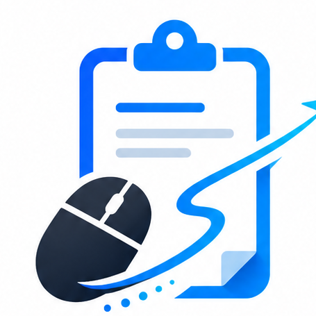
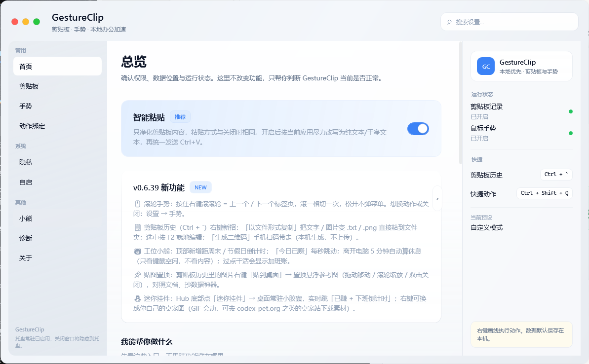
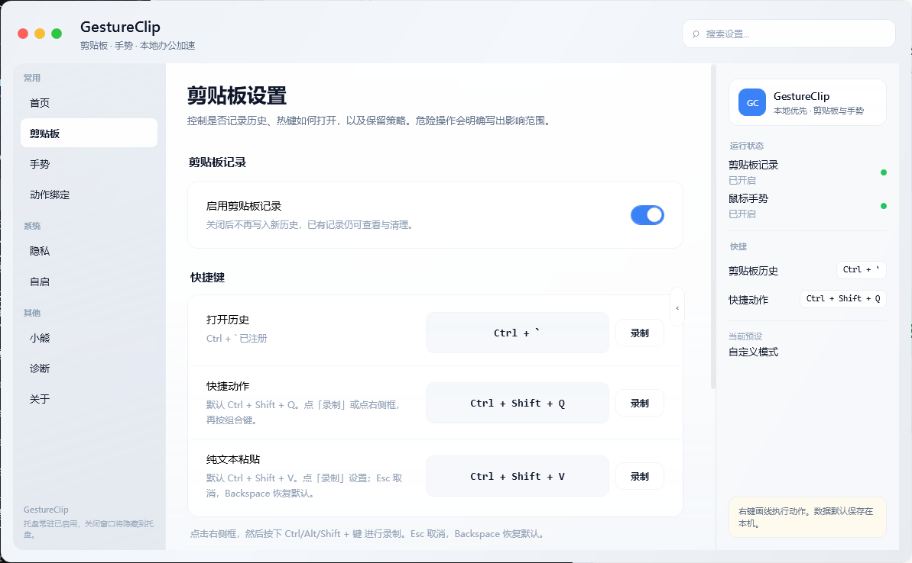
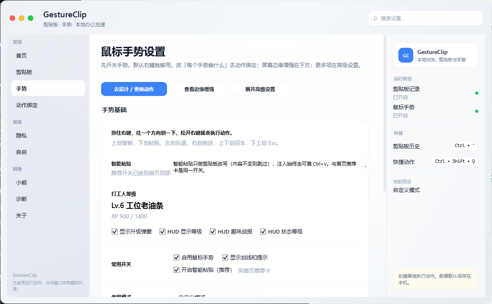
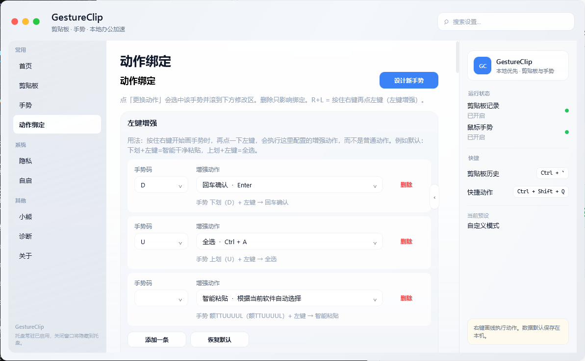
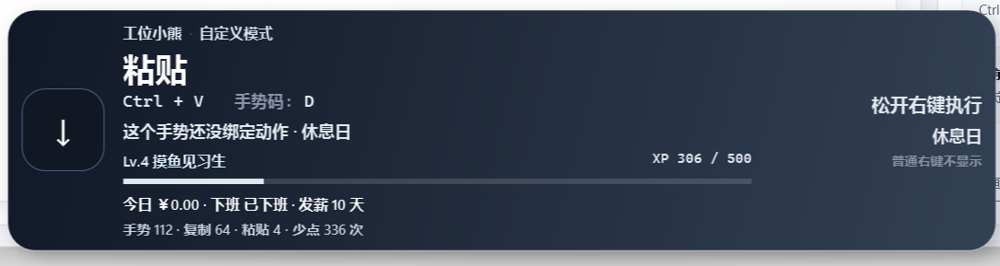
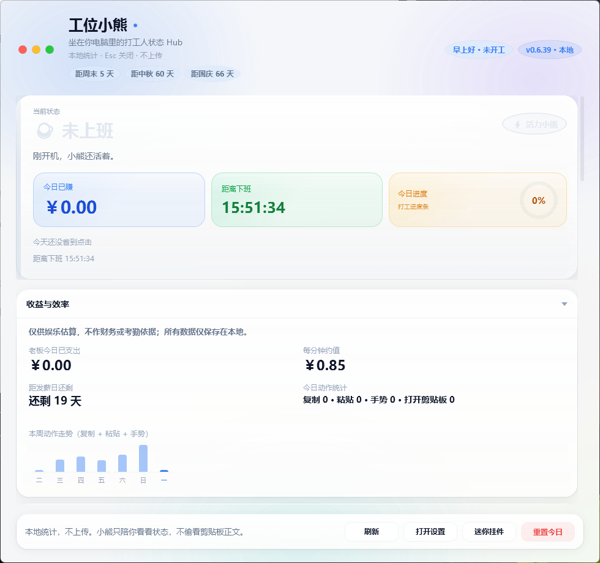

# GestureClip

<p align="center">
  
</p>

<p align="center">
  <strong>Windows 本地优先</strong>的剪贴板历史 + 鼠标手势 + 本地文本助手
</p>

<p align="center">
  <a href="https://github.com/hhuhuwang-gif/GestureClip.App/releases/latest"></a>
  <a href="https://github.com/hhuhuwang-gif/GestureClip.App/releases/latest"></a>
  
  
</p>

<p align="center">
  复制过的文字 / 图片能找回来 · 右键一划完成常用操作 · 本地文本处理<br />
  <strong>不登录 · 不上传 · 不云同步</strong>
</p>

<p align="center">
  <a href="https://github.com/hhuhuwang-gif/GestureClip.App/releases/latest"><strong>⬇ 下载最新版（Latest）</strong></a>
  ·
  <a href="https://github.com/hhuhuwang-gif/GestureClip.App/releases/download/v0.6.45-beta/GestureClip-v0.6.45-beta-win-x64.zip"><strong>v0.6.45 Beta zip</strong></a>
  ·
  <a href="https://github.com/hhuhuwang-gif/GestureClip.App/releases/tag/v0.6.45-beta">Release 说明</a>
  ·
  <a href="CHANGELOG.md">更新日志</a>
</p>



---

## 目录

- [30 秒上手](#30-秒上手)
- [当前版本](#当前版本v0645-beta)
- [核心功能](#核心功能)
- [数据与隐私](#数据与隐私)
- [安装与更新](#安装与更新)
- [常见问题](#常见问题)
- [开发与发布](#开发与发布)
- [截图](#截图)

---

## 30 秒上手

更完整的图文导览见 [docs/DEMO_30S.md](docs/DEMO_30S.md)。代码签名说明见 [docs/CODE_SIGNING.md](docs/CODE_SIGNING.md)。

| 你想做的事 | 怎么做 |
| --- | --- |
| 打开剪贴板历史 | `Ctrl + \`` |
| 找回刚复制过的文字 / 图片 | 历史里搜索 → 双击复制，或 Enter 粘贴 |
| 右键手势 | **按住右键**上划复制、下划粘贴、左划后退、右划前进 |
| 本地文本处理 | `Ctrl + Shift + Q` 打开快捷动作 |
| 工位小熊（可选） | 托盘 → 工位小熊 → 填月薪与上下班时间 |

推荐下载 **Setup zip**，解压后双击 `Setup.cmd` 安装到当前用户目录；也可解压便携 zip 后直接双击 `GestureClip.exe`（Windows x64 self-contained，一般**无需**安装 .NET）。

---

## 当前版本：v0.6.45 Beta

| 资源 | 链接 |
| --- | --- |
| **推荐下载（Latest）** | [Releases / latest](https://github.com/hhuhuwang-gif/GestureClip.App/releases/latest) |
| 安装包 | [GestureClip-Setup-v0.6.45-beta-win-x64.zip](https://github.com/hhuhuwang-gif/GestureClip.App/releases/download/v0.6.45-beta/GestureClip-Setup-v0.6.45-beta-win-x64.zip) |
| 便携包 | [GestureClip-v0.6.45-beta-win-x64.zip](https://github.com/hhuhuwang-gif/GestureClip.App/releases/download/v0.6.45-beta/GestureClip-v0.6.45-beta-win-x64.zip) |
| 校验文件 | [SHA256SUMS.txt](https://github.com/hhuhuwang-gif/GestureClip.App/releases/download/v0.6.45-beta/SHA256SUMS.txt) |
| 历史版本 | 旧版在 Releases 里标记为 **Pre-release**，默认请用 Latest |

### 本版亮点（v0.6.45）

- **滚动真正顺滑**：设置窗口改为 DWM 合成窗口，不再被 WPF 强制软件渲染；平均帧间隔从 18~20ms 降到 16~17ms，滚轮按下立即响应，不再有"顿一下再滑"。
- **手势提示更好看**：HUD 改为数码方块流动渐变，方块内青→靛→紫→品红缓慢流动，配斜向副数据流与扫描光柱。
- **最大化不再挡任务栏**：最大化尺寸约束在显示器工作区内。
- **文本更清晰**：改用 Display 排版与灰度抗锯齿，滚动中字形不抖动。详见 [v0.6.45 Release 说明](docs/github-release-v0.6.45-beta.md)。

### 延续功能（v0.6.44）

- **滚动回弹修复**：滚轮输入统一累积到目标偏移，反向滚动不再丢弃已累积行程，落点准确。
- **滚动开销更低**：移除每帧字符串分配与边界无效布局，长页面翻动更跟手。
- **界面细节**：胶囊滚动条、卡片层次与导航选中态统一，浅色/深色主题观感一致。详见 [v0.6.44 Release 说明](docs/github-release-v0.6.44-beta.md)。

### 延续功能（v0.6.43）

- **粘贴更快更稳**：纯文本粘贴改为等待真实目标焦点和按键释放，移除固定延迟，失败直接报错，避免重复粘贴。
- **快捷动作中心**：新的双栏预览界面，支持 Shift+Enter 预览、Ctrl+Enter 处理并粘贴、F5 刷新。
- **应用手势与深色主题**：可复制应用配置、快速录入方向，并完成应用配置、粘贴队列、休息提醒的浅深主题统一。详见 [v0.6.43 Release 说明](docs/github-release-v0.6.43-beta.md)。

### 更早版本延续功能

- **手势响应专项优化**：全局鼠标钩子迁到独立线程，UI 忙碌时仍能及时接收手势
- **高频轨迹合帧**：HUD 约 24ms 刷新一次，只绘制最新帧，快速拖动不再淹没 UI 队列
- **轻量轨迹渲染**：移除全屏实时模糊阴影，保留双层发光效果并降低 GPU / 软件渲染压力
- **剪贴板稳定性增强**：快速连续复制按顺序处理，图片与瞬时读取失败不再容易丢失
- **滚轮手势**：按住右键滚滚轮切标签（动作可改、可连发、不弹菜单）
- **剪贴板增强**：以文件形式复制（.txt/.png）、F2 就地编辑、二维码扫码带走、**图片贴图置顶**
- **小熊迷你挂件**：桌面常驻已赚 + 倒计时小胶囊，可换自定义桌宠 GIF
- **小熊升级**：节假日倒计时、收益秒级跳动、活动驱动休息判断、加班统计
- **Hub 液态玻璃视觉升级**：镜面高光描边、内部光泽、环境色晕（亮 / 暗双主题）
- 修复暗色主题无 Mica 回退时窗口背景误用浅色
- **含 0.6.38**：剪贴板搜索修复与增强（拼音首字母、`re:` 正则、链接筛选）、文本工具

---

## 适合谁？

- 每天大量复制粘贴的办公、客服、运营、开发、写作用户
- 想用鼠标手势提速，但不想装臃肿软件
- 需要**本机**剪贴板历史，拒绝内容上云
- 想要轻量、可关闭的打工状态反馈（工位小熊）

---

## 核心功能

### 1. 剪贴板历史

- 文本 + 图片 / 截图，支持搜索（拼音首字母 / `re:` 正则 / 链接筛选）、固定、收藏、多选合并复制
- 左侧色条：蓝=文本 · 紫=图片 · 橙=置顶 · **绿=本会话已复制**
- **F2 就地编辑**：选中历史直接改内容，覆盖原记录不新建
- **以文件形式复制**：文本变 .txt、图片变 .png，直接 Ctrl+V 粘贴到资源管理器
- **生成二维码**：文本条目本机生成二维码，手机扫码带走，不上传
- **贴图置顶**：历史图片一键贴到桌面变置顶参考图（拖动 / 滚轮缩放 / 双击关闭，可贴多张）
- 可暂停记录；数据在本机 SQLite



### 2. 快捷键

| 默认快捷键 | 作用 |
| --- | --- |
| `Ctrl + \`` | 打开 / 关闭剪贴板历史 |
| `Ctrl + Shift + Q` | 快捷动作面板（本地文本助手） |
| `Ctrl + Shift + V` | 纯文本粘贴（可在设置中改） |

均可在设置中修改。

### 3. 快捷动作（本地助手）

对当前剪贴板文本做**纯本地**处理：去空格、大小写、JSON 美化/压缩、URL 编解码、HTML→纯文本、链接去追踪参数等。  
结果可预览、写回剪贴板或直接粘贴。**不登录、不上传。**

### 4. 鼠标右键手势

按住右键划出轨迹，松开执行。

| 手势 | 默认动作 |
| --- | --- |
| 上划 | 复制 `Ctrl+C` |
| 下划 | 粘贴 `Ctrl+V`（智能粘贴按应用策略净化） |
| 上下 / 下上 | 回车 / Esc |
| 左 / 右 | 后退 / 前进 |
| 左右 / 右左 | 全选 / 撤销 |
| 下左 | 粘贴并回车 |
| **按住右键 + 滚轮** | 上 / 下一个标签页（可改任意动作，滚一格触发一次） |

可在设置中自定义绑定；支持左键增强、摇杆手势、屏幕边缘角落触发等高级手势。





### 5. 手势 HUD + 工位小熊（可选）

划手势时显示当前动作；可打开工位小熊看今日收益估算、下班倒计时、复制/粘贴统计与等级。**可关闭。**

- **今日已赚每秒跳动** + 距周末 / 法定节假日倒计时（本地内置假日表）
- **活动驱动休息判断**：离开电脑 5 分钟自动算休息，人在休息不弹提醒（只看键鼠空闲，不识别应用）
- 过了下班点显示**加班账**：已加班时长 ≈ 白送老板多少钱
- **迷你挂件**：桌面常驻置顶小胶囊（已赚 + 倒计时），可拖动、可换自定义桌宠图（GIF 会动）





---

## 数据与隐私

| 原则 | 说明 |
| --- | --- |
| 本地优先 | 不需要账号，不云同步 |
| 不上云 | 不上传剪贴板正文、图片、工资与统计 |
| 最小权限 | 不读浏览器正文、密码、Token、Cookie |
| 可关可清 | 可暂停剪贴板 / 手势；可清空历史；可设应用黑名单 |
| 安全导出 | 诊断包不含数据库与图片原图；日志不含剪贴板正文 |

```text
数据：%LOCALAPPDATA%\GestureClip\gestureclip.db
日志：%LOCALAPPDATA%\GestureClip\logs\
```

**覆盖更新程序不会删除**历史与设置。更多：[PRIVACY.md](PRIVACY.md) · [KNOWN_ISSUES.md](KNOWN_ISSUES.md) · [ROADMAP.md](ROADMAP.md)

---

## 安装与更新

1. 打开 [最新 Release（Latest）](https://github.com/hhuhuwang-gif/GestureClip.App/releases/latest)
2. 下载 `GestureClip-v*-win-x64.zip`（可对照 `SHA256SUMS.txt`）
3. 若已在运行：先退出，任务管理器确认无 `GestureClip.exe`
4. 解压覆盖旧目录（或新目录首次使用）
5. 双击 `GestureClip.exe`

应用内：**设置 / 托盘 → 检查更新** 也可下载新版。  
用户数据始终在 `%LOCALAPPDATA%\GestureClip\`。详见 [UPDATE.md](UPDATE.md)。

> 当前 Beta **未代码签名**，SmartScreen 可能提示「未知发布者」，属预期现象。  
> Releases 列表里旧版本标为 **Pre-release**，请优先下载带 **Latest** 的版本。

---

## 常见问题

**管理员窗口里手势 / 粘贴不生效？**  
普通权限进程通常无法控制管理员窗口。需要时请以管理员身份运行 GestureClip。

**图片搜不到？**  
清空搜索框，或切到「图片」筛选。

**从历史复制网页 / ChatGPT 内容再贴不完整？**  
v0.6.37 起历史再复制会统一写成纯文本；也可用「复制为纯文本」或 `Ctrl+Shift+C`。

**剪贴板图片粘到别的软件无效？**  
复制图片时会同时写入 Bitmap / PNG / DIB。

**检查更新失败？**  
可手动到 [Latest](https://github.com/hhuhuwang-gif/GestureClip.App/releases/latest) 下载。

**为什么 GitHub 上还有很多旧版本？**  
历史包仍保留下载；已标为 Pre-release。日常请只用 **Latest = v0.6.45 Beta**。

---

## 开发与发布

连续复制、纯文本粘贴、附件导出和键盘分类操作见 [办公快捷操作](docs/OFFICE_WORKFLOW.md)。

安装 .NET 8 SDK，双击 `build-exe.bat` 完成测试和便携版构建，双击 `Start-GestureClip.bat` 启动。

`Start-GestureClip.bat` 启动前会比对源码与可执行文件的时间戳：源码更新过就提示选择「快速 Debug 编译并启动 / 完整重建发布包 / 仍然启动旧版本」，不会再静默跑旧代码。命令行参数：

```powershell
.\Start-GestureClip.bat --quick      # 增量编译 Debug 并启动，改 UI 时最快
.\Start-GestureClip.bat --rebuild    # 无条件完整重建发布包后启动
.\Start-GestureClip.bat --no-check   # 跳过新鲜度检查，直接启动现有产物
.\Start-GestureClip.bat --trace-scroll  # 其余参数原样转发给 GestureClip.exe
.\Start-GestureClip.bat --trace-ui      # 记录设置窗口构造与切页耗时
```

```powershell
# 构建便携版 + 安装包（包含测试；每次测试限时 60 秒）
powershell -NoProfile -ExecutionPolicy Bypass -File .\scripts\build-setup.ps1
# 校验 SHA256、包内程序一致性与本地数据排除
powershell -NoProfile -ExecutionPolicy Bypass -File .\scripts\check-release.ps1 -RequireSetup
```

产物统一在 `artifacts\release\`，可执行文件为 `GestureClip\GestureClip.exe`。开发命令、目录职责见 [开发指南](docs/DEVELOPMENT.md)。

---

## 截图

| 首页 | 剪贴板 |
| --- | --- |
|  |  |

| 手势 | 动作绑定 |
| --- | --- |
|  |  |

| HUD | 工位小熊 |
| --- | --- |
|  |  |

---

<p align="center">
  Made for Windows · Local first · <a href="https://github.com/hhuhuwang-gif/GestureClip.App/issues">反馈 Issue</a>
</p>
