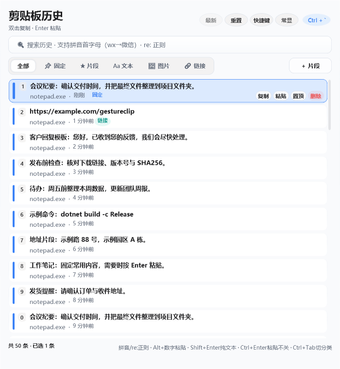
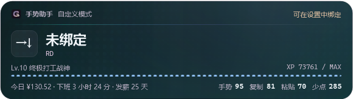
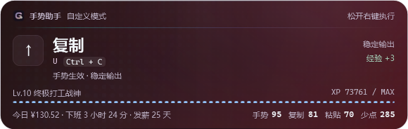

# GestureClip v0.6.48 Beta

Windows 本地剪贴板历史、鼠标手势和快捷操作宏。本版重点是剪贴板首屏、手势提示和快速录制。

- **剪贴板**：默认宽度从 860 缩到 700。压缩条目和页脚，文字保留两行预览。快捷操作仅在选中或悬停时创建，图片行才加载缩略图。条目绿条仍表示本会话已复制。
- **录制与回放**：按住右键快速画 `<` 开始或停止录制，画 `>` 回放或中止。短划保留实际采样的拐点，并在松键时补入终点。录制指令无需等待浮层关闭，面板明确区分正在启动、保存中和已保存。
- **手势浮层和图标**：保留精简布局，并恢复跟随工作时段的渐变颜色。程序、窗口和托盘统一使用三色渐变 G。

## 界面截图

以下是 v0.6.48 用示例数据渲染的界面。

| 剪贴板历史 | 录制手势 |
| --- | --- |
|  |  |

| 上午浮层 | 下午浮层 |
| --- | --- |
|  |  |

## 下载与更新

- `GestureClip-Setup-v0.6.48-beta-win-x64.zip`：解压后运行 `Setup.cmd`。
- `GestureClip-v0.6.48-beta-win-x64.zip`：便携版，解压后运行 `GestureClip.exe`。
- `SHA256SUMS.txt`：校验下载文件。
- 更新前先从托盘退出旧版，剪贴板历史、设置与宏保存在 `%LOCALAPPDATA%\GestureClip`。

## 剪贴板实测

同一台 Windows 电脑上，用独立 SQLite 库和 240 条混合记录实测四轮。首开到首次绘制中位数约 331 ms，首批 50 条就绪并绘制约 748 ms。普通重开 20 次中位数约 35 ms。连续下滚共 120 次，均推进列表，单轮的滚轮至下一渲染回调 P95 为 5.3–9.2 ms。续页中位数约 345 ms，翻页后重开约 392 ms。这些是本机样本，首次打开指窗口未预热，滚动数据不是整屏帧率。
